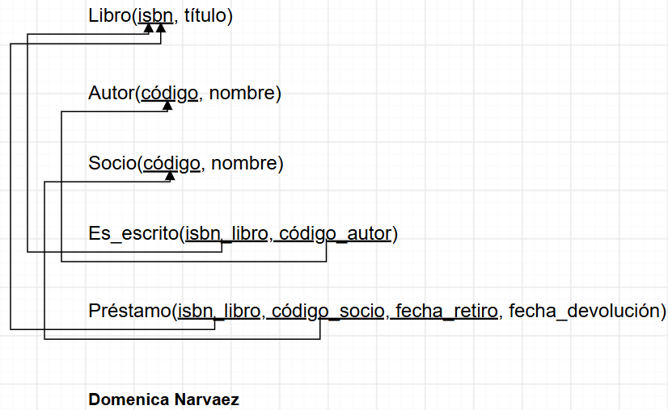
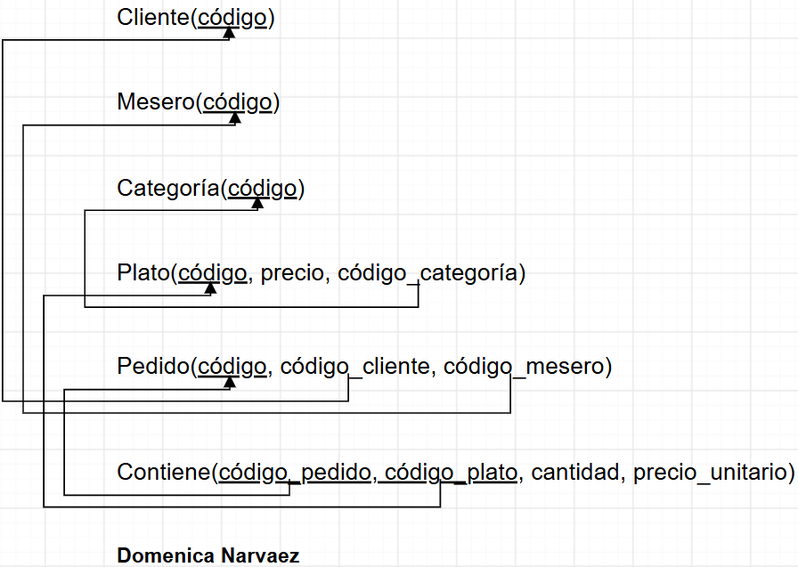
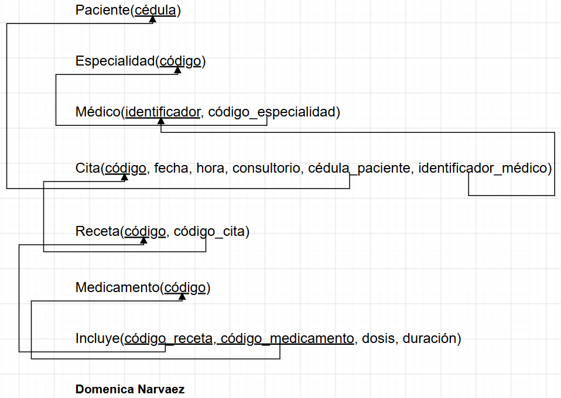
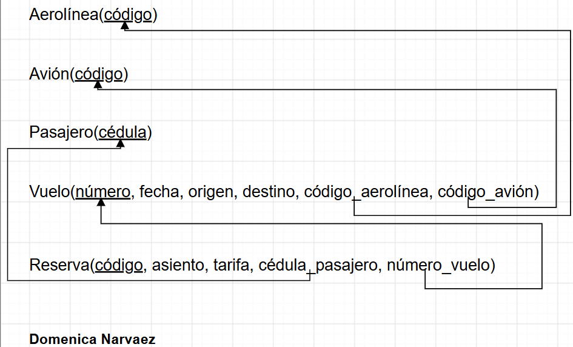
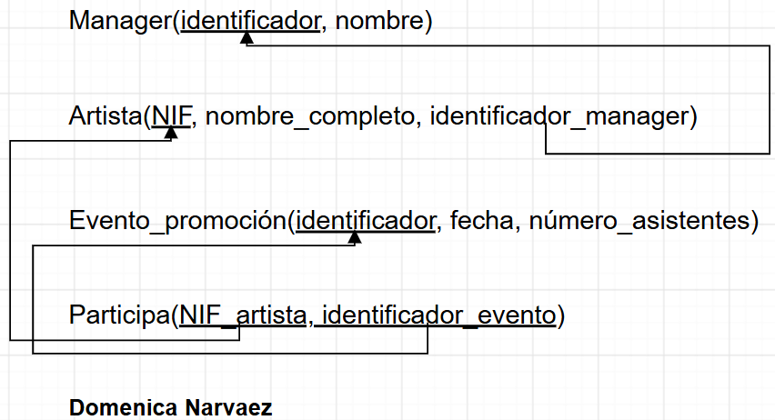
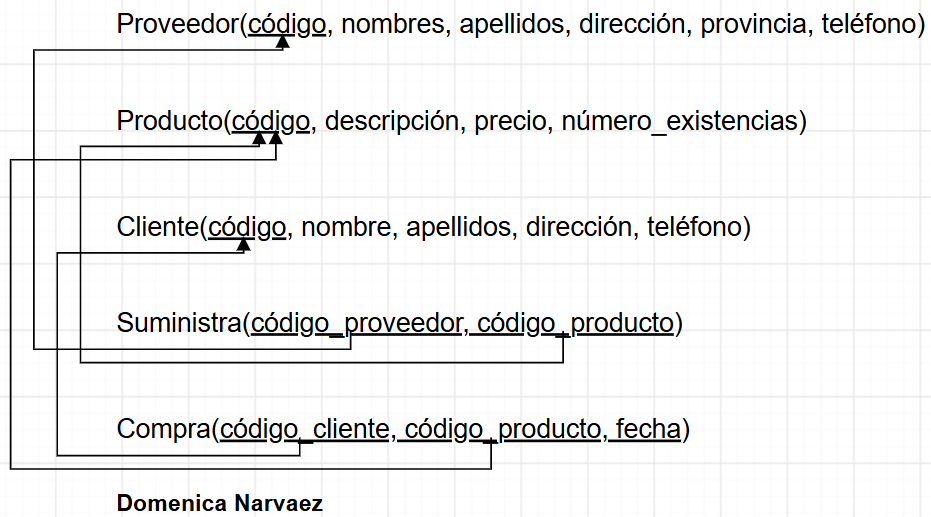
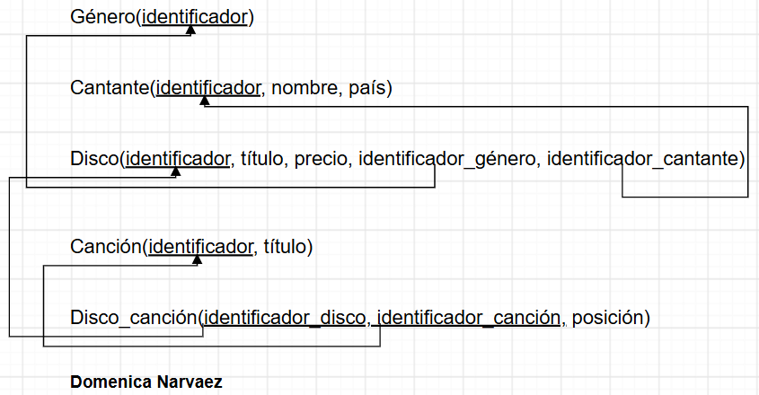
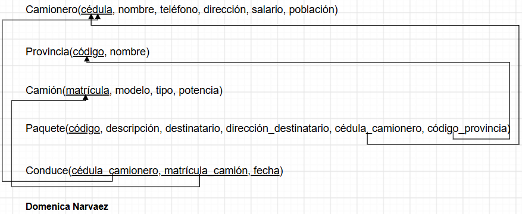
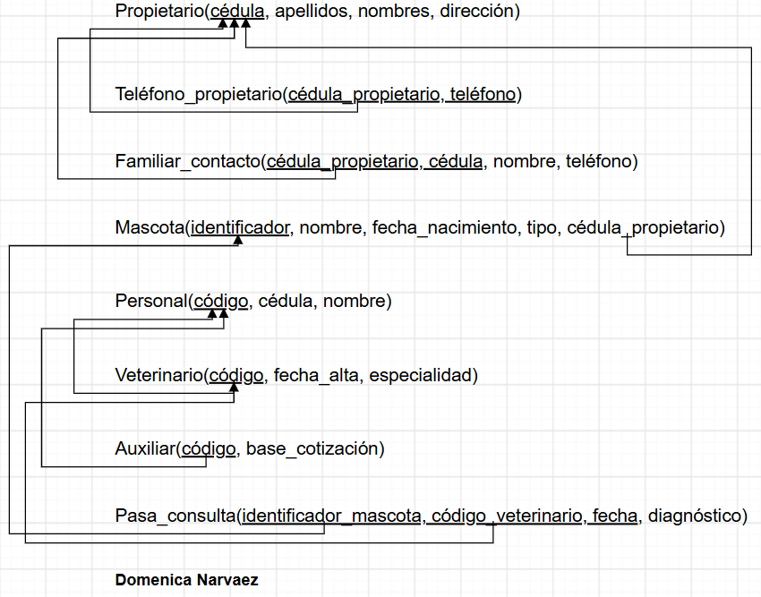

# Modelo Relacional

[🏠 Volver al inicio](../../README.md)

## Índice

1. [Ejemplo 1: Sistema de Biblioteca](#ejercicio-1)
2. [Ejemplo 2: Pedidos de Restaurante](#ejercicio-2)
3. [Ejemplo 3: Clínica Médica](#ejercicio-3)
4. [Ejemplo 4: Sistema de Aerolínea](#ejercicio-4)
5. [Ejercicio 5: Empresa Discográfica](#ejercicio-5)
6. [Ejercicio 6: Tienda Informática](#ejercicio-6)
7. [Ejercicio 7: Discos Musicales](#ejercicio-7)
8. [Ejercicio 8: Camiones](#ejercicio-8)
9. [Ejercicio 9: Veterinaria](#ejercicio-9)

---

## Ejemplo 1: Sistema de Biblioteca

**Ver este ejercicio en:** [🔷 Entidad-Relación](../1_Entidad_Relacion/README.md#ejercicio-1) · [💾 SQL](../3_SQL/README.md#ejercicio-1)

[⬆ Volver al índice](#índice) · [🏠 Volver al inicio](../../README.md)

---

## Ejemplo 2: Pedidos de Restaurante

**Ver este ejercicio en:** [🔷 Entidad-Relación](../1_Entidad_Relacion/README.md#ejercicio-2) · [💾 SQL](../3_SQL/README.md#ejercicio-2)

[⬆ Volver al índice](#índice) · [🏠 Volver al inicio](../../README.md)

---

## Ejemplo 3: Clínica Médica

**Ver este ejercicio en:** [🔷 Entidad-Relación](../1_Entidad_Relacion/README.md#ejercicio-3) · [💾 SQL](../3_SQL/README.md#ejercicio-3)

[⬆ Volver al índice](#índice) · [🏠 Volver al inicio](../../README.md)

---

## Ejemplo 4: Sistema de Aerolínea

**Ver este ejercicio en:** [🔷 Entidad-Relación](../1_Entidad_Relacion/README.md#ejercicio-4) · [💾 SQL](../3_SQL/README.md#ejercicio-4)

[⬆ Volver al índice](#índice) · [🏠 Volver al inicio](../../README.md)

---

## Ejercicio 5: Empresa Discográfica

**Ver este ejercicio en:** [🔷 Entidad-Relación](../1_Entidad_Relacion/README.md#ejercicio-5) · [💾 SQL](../3_SQL/README.md#ejercicio-5)

[⬆ Volver al índice](#índice) · [🏠 Volver al inicio](../../README.md)

---

## Ejercicio 6: Tienda Informática

**Ver este ejercicio en:** [🔷 Entidad-Relación](../1_Entidad_Relacion/README.md#ejercicio-6) · [💾 SQL](../3_SQL/README.md#ejercicio-6)

[⬆ Volver al índice](#índice) · [🏠 Volver al inicio](../../README.md)

---

## Ejercicio 7: Discos Musicales

**Ver este ejercicio en:** [🔷 Entidad-Relación](../1_Entidad_Relacion/README.md#ejercicio-7) · [💾 SQL](../3_SQL/README.md#ejercicio-7)

[⬆ Volver al índice](#índice) · [🏠 Volver al inicio](../../README.md)

---

## Ejercicio 8: Camiones

**Ver este ejercicio en:** [🔷 Entidad-Relación](../1_Entidad_Relacion/README.md#ejercicio-8) · [💾 SQL](../3_SQL/README.md#ejercicio-8)

[⬆ Volver al índice](#índice) · [🏠 Volver al inicio](../../README.md)

---

## Ejercicio 9: Veterinaria

**Ver este ejercicio en:** [🔷 Entidad-Relación](../1_Entidad_Relacion/README.md#ejercicio-9) · [💾 SQL](../3_SQL/README.md#ejercicio-9)

[⬆ Volver al índice](#índice) · [🏠 Volver al inicio](../../README.md)

---
