# Código SQL (MySQL)

[🏠 Volver al inicio](../../README.md)

## Índice

1. [Ejemplo 1: Sistema de Biblioteca](#ejercicio-1)
2. [Ejemplo 2: Pedidos de Restaurante](#ejercicio-2)
3. [Ejemplo 3: Clínica Médica](#ejercicio-3)
4. [Ejemplo 4: Sistema de Aerolínea](#ejercicio-4)
5. [Ejercicio 5: Empresa Discográfica](#ejercicio-5)
6. [Ejercicio 6: Tienda Informática](#ejercicio-6)
7. [Ejercicio 7: Discos Musicales](#ejercicio-7)
8. [Ejercicio 8: Camiones](#ejercicio-8)
9. [Ejercicio 9: Veterinaria](#ejercicio-9)

---

<a id="ejercicio-1"></a>

## Ejemplo 1: Sistema de Biblioteca

📄 Archivo: [`01_biblioteca.sql`](01_biblioteca.sql)

```sql
CREATE DATABASE biblioteca;
USE biblioteca;

CREATE TABLE Libro (
    isbn    VARCHAR(13)  PRIMARY KEY,
    titulo  VARCHAR(100) NOT NULL
);

CREATE TABLE Autor (
    codigo  VARCHAR(10)  PRIMARY KEY,
    nombre  VARCHAR(80)  NOT NULL
);

CREATE TABLE Socio (
    codigo  VARCHAR(10)  PRIMARY KEY,
    nombre  VARCHAR(80)  NOT NULL
);

CREATE TABLE Es_escrito (
    isbn_libro    VARCHAR(13),
    codigo_autor  VARCHAR(10),
    PRIMARY KEY (isbn_libro, codigo_autor),
    FOREIGN KEY (isbn_libro)   REFERENCES Libro(isbn),
    FOREIGN KEY (codigo_autor) REFERENCES Autor(codigo)
);

CREATE TABLE Prestamo (
    isbn_libro        VARCHAR(13),
    codigo_socio      VARCHAR(10),
    fecha_retiro      DATE,
    fecha_devolucion  DATE,
    PRIMARY KEY (isbn_libro, codigo_socio, fecha_retiro),
    FOREIGN KEY (isbn_libro)   REFERENCES Libro(isbn),
    FOREIGN KEY (codigo_socio) REFERENCES Socio(codigo)
);
```

### Evidencia

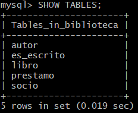

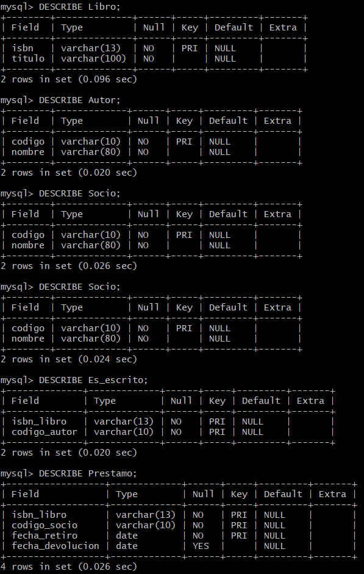


**Ver este ejercicio en:** [🔷 Entidad-Relación](../1_Entidad_Relacion/README.md#ejercicio-1) · [🔶 Relacional](../2_Relacional/README.md#ejercicio-1)

[⬆ Volver al índice](#índice) · [🏠 Volver al inicio](../../README.md)

---

<a id="ejercicio-2"></a>

## Ejemplo 2: Pedidos de Restaurante

📄 Archivo: [`02_restaurante.sql`](02_restaurante.sql)

```sql
CREATE DATABASE restaurante;
USE restaurante;

CREATE TABLE Cliente (
    codigo  VARCHAR(10) PRIMARY KEY
);

CREATE TABLE Mesero (
    codigo  VARCHAR(10) PRIMARY KEY
);

CREATE TABLE Categoria (
    codigo  VARCHAR(10) PRIMARY KEY
);

CREATE TABLE Plato (
    codigo            VARCHAR(10)   PRIMARY KEY,
    precio            DECIMAL(8,2)  NOT NULL,
    codigo_categoria  VARCHAR(10)   NOT NULL,
    FOREIGN KEY (codigo_categoria) REFERENCES Categoria(codigo)
);

CREATE TABLE Pedido (
    codigo          VARCHAR(10) PRIMARY KEY,
    codigo_cliente  VARCHAR(10) NOT NULL,
    codigo_mesero   VARCHAR(10) NOT NULL,
    FOREIGN KEY (codigo_cliente) REFERENCES Cliente(codigo),
    FOREIGN KEY (codigo_mesero)  REFERENCES Mesero(codigo)
);

CREATE TABLE Contiene (
    codigo_pedido    VARCHAR(10),
    codigo_plato     VARCHAR(10),
    cantidad         INT           NOT NULL CHECK (cantidad > 0),
    precio_unitario  DECIMAL(8,2)  NOT NULL,
    PRIMARY KEY (codigo_pedido, codigo_plato),
    FOREIGN KEY (codigo_pedido) REFERENCES Pedido(codigo),
    FOREIGN KEY (codigo_plato)  REFERENCES Plato(codigo)
);
```

### Evidencia

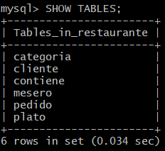

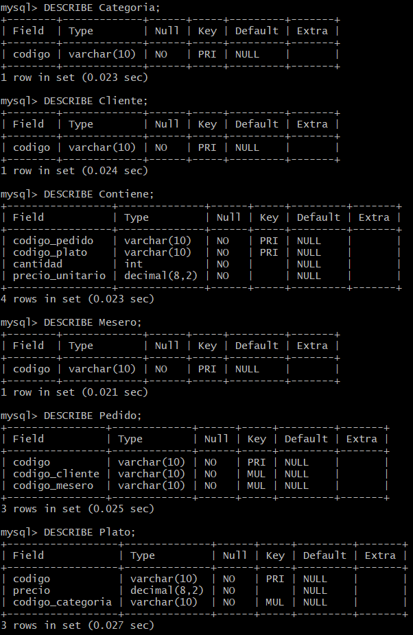


**Ver este ejercicio en:** [🔷 Entidad-Relación](../1_Entidad_Relacion/README.md#ejercicio-2) · [🔶 Relacional](../2_Relacional/README.md#ejercicio-2)

[⬆ Volver al índice](#índice) · [🏠 Volver al inicio](../../README.md)

---

<a id="ejercicio-3"></a>

## Ejemplo 3: Clínica Médica

📄 Archivo: [`03_clinica.sql`](03_clinica.sql)

```sql
CREATE DATABASE clinica;
USE clinica;

CREATE TABLE Paciente (
    cedula  VARCHAR(10) PRIMARY KEY
);

CREATE TABLE Especialidad (
    codigo  VARCHAR(10) PRIMARY KEY
);

CREATE TABLE Medico (
    identificador        VARCHAR(10) PRIMARY KEY,
    codigo_especialidad  VARCHAR(10) NOT NULL,
    FOREIGN KEY (codigo_especialidad) REFERENCES Especialidad(codigo)
);

CREATE TABLE Cita (
    codigo                VARCHAR(10) PRIMARY KEY,
    fecha                 DATE        NOT NULL,
    hora                  TIME        NOT NULL,
    consultorio           VARCHAR(20) NOT NULL,
    cedula_paciente       VARCHAR(10) NOT NULL,
    identificador_medico  VARCHAR(10) NOT NULL,
    FOREIGN KEY (cedula_paciente)      REFERENCES Paciente(cedula),
    FOREIGN KEY (identificador_medico) REFERENCES Medico(identificador)
);

CREATE TABLE Receta (
    codigo       VARCHAR(10) PRIMARY KEY,
    codigo_cita  VARCHAR(10) NOT NULL UNIQUE,
    FOREIGN KEY (codigo_cita) REFERENCES Cita(codigo)
);

CREATE TABLE Medicamento (
    codigo  VARCHAR(10) PRIMARY KEY
);

CREATE TABLE Incluye (
    codigo_receta       VARCHAR(10),
    codigo_medicamento  VARCHAR(10),
    dosis               VARCHAR(50) NOT NULL,
    duracion            VARCHAR(50) NOT NULL,
    PRIMARY KEY (codigo_receta, codigo_medicamento),
    FOREIGN KEY (codigo_receta)      REFERENCES Receta(codigo),
    FOREIGN KEY (codigo_medicamento) REFERENCES Medicamento(codigo)
);
```

### Evidencia

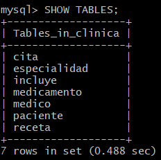

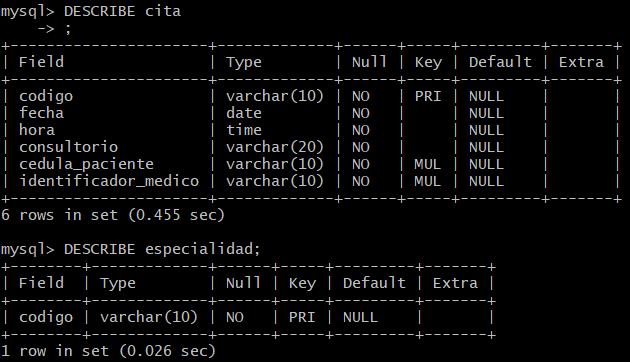

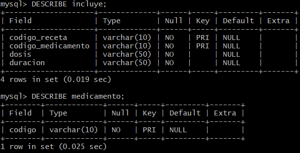

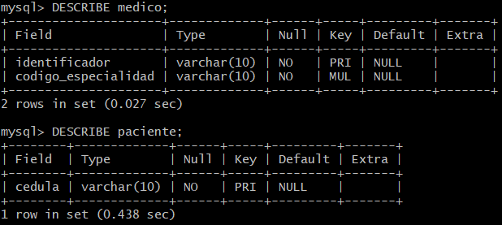

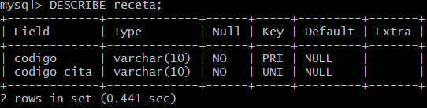


**Ver este ejercicio en:** [🔷 Entidad-Relación](../1_Entidad_Relacion/README.md#ejercicio-3) · [🔶 Relacional](../2_Relacional/README.md#ejercicio-3)

[⬆ Volver al índice](#índice) · [🏠 Volver al inicio](../../README.md)

---

<a id="ejercicio-4"></a>

## Ejemplo 4: Sistema de Aerolínea

📄 Archivo: [`04_aerolinea.sql`](04_aerolinea.sql)

```sql
CREATE DATABASE aerolinea;
USE aerolinea;

CREATE TABLE Aerolinea (
    codigo  VARCHAR(10) PRIMARY KEY
);

CREATE TABLE Avion (
    codigo  VARCHAR(10) PRIMARY KEY
);

CREATE TABLE Pasajero (
    cedula  VARCHAR(10) PRIMARY KEY
);

CREATE TABLE Vuelo (
    numero            VARCHAR(10) PRIMARY KEY,
    fecha             DATE        NOT NULL,
    origen            VARCHAR(50) NOT NULL,
    destino           VARCHAR(50) NOT NULL,
    codigo_aerolinea  VARCHAR(10) NOT NULL,
    codigo_avion      VARCHAR(10) NOT NULL,
    FOREIGN KEY (codigo_aerolinea) REFERENCES Aerolinea(codigo),
    FOREIGN KEY (codigo_avion)     REFERENCES Avion(codigo)
);

CREATE TABLE Reserva (
    codigo           VARCHAR(10)    PRIMARY KEY,
    asiento          VARCHAR(5)     NOT NULL,
    tarifa           DECIMAL(10,2)  NOT NULL,
    cedula_pasajero  VARCHAR(10)    NOT NULL,
    numero_vuelo     VARCHAR(10)    NOT NULL,
    UNIQUE (numero_vuelo, asiento),
    FOREIGN KEY (cedula_pasajero) REFERENCES Pasajero(cedula),
    FOREIGN KEY (numero_vuelo)    REFERENCES Vuelo(numero)
);
```

### Evidencia

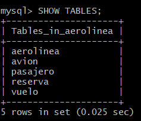

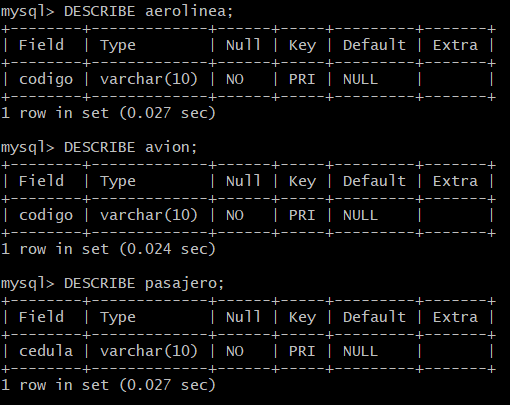

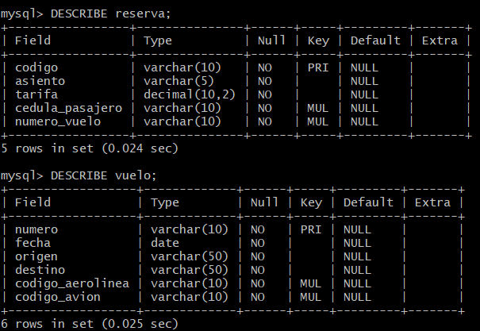


**Ver este ejercicio en:** [🔷 Entidad-Relación](../1_Entidad_Relacion/README.md#ejercicio-4) · [🔶 Relacional](../2_Relacional/README.md#ejercicio-4)

[⬆ Volver al índice](#índice) · [🏠 Volver al inicio](../../README.md)

---

<a id="ejercicio-5"></a>

## Ejercicio 5: Empresa Discográfica

📄 Archivo: [`05_discografica.sql`](05_discografica.sql)

```sql
CREATE DATABASE discografica;
USE discografica;

CREATE TABLE Manager (
    identificador  VARCHAR(10) PRIMARY KEY,
    nombre         VARCHAR(80) NOT NULL
);

CREATE TABLE Artista (
    NIF                    VARCHAR(15)  PRIMARY KEY,
    nombre_completo        VARCHAR(120) NOT NULL,
    identificador_manager  VARCHAR(10)  NOT NULL,
    FOREIGN KEY (identificador_manager) REFERENCES Manager(identificador)
);

CREATE TABLE Evento_promocion (
    identificador      VARCHAR(10) PRIMARY KEY,
    fecha              DATE        NOT NULL,
    numero_asistentes  INT         CHECK (numero_asistentes >= 0)
);

CREATE TABLE Participa (
    NIF_artista           VARCHAR(15),
    identificador_evento  VARCHAR(10),
    PRIMARY KEY (NIF_artista, identificador_evento),
    FOREIGN KEY (NIF_artista)          REFERENCES Artista(NIF),
    FOREIGN KEY (identificador_evento) REFERENCES Evento_promocion(identificador)
);
```

### Evidencia

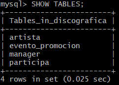

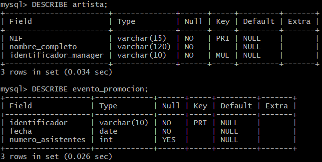

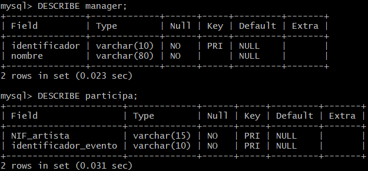


**Ver este ejercicio en:** [🔷 Entidad-Relación](../1_Entidad_Relacion/README.md#ejercicio-5) · [🔶 Relacional](../2_Relacional/README.md#ejercicio-5)

[⬆ Volver al índice](#índice) · [🏠 Volver al inicio](../../README.md)

---

<a id="ejercicio-6"></a>

## Ejercicio 6: Tienda Informática

📄 Archivo: [`06_tienda_informatica.sql`](06_tienda_informatica.sql)

```sql
CREATE DATABASE tienda_informatica;
USE tienda_informatica;

CREATE TABLE Proveedor (
    codigo     VARCHAR(10)  PRIMARY KEY,
    nombres    VARCHAR(80)  NOT NULL,
    apellidos  VARCHAR(80)  NOT NULL,
    direccion  VARCHAR(150),
    provincia  VARCHAR(50),
    telefono   VARCHAR(15)
);

CREATE TABLE Producto (
    codigo              VARCHAR(10)    PRIMARY KEY,
    descripcion         VARCHAR(150)   NOT NULL,
    precio              DECIMAL(10,2)  NOT NULL,
    numero_existencias  INT            NOT NULL CHECK (numero_existencias >= 0)
);

CREATE TABLE Cliente (
    codigo     VARCHAR(10)  PRIMARY KEY,
    nombre     VARCHAR(80)  NOT NULL,
    apellidos  VARCHAR(80)  NOT NULL,
    direccion  VARCHAR(150),
    telefono   VARCHAR(15)
);

CREATE TABLE Suministra (
    codigo_proveedor  VARCHAR(10),
    codigo_producto   VARCHAR(10),
    PRIMARY KEY (codigo_proveedor, codigo_producto),
    FOREIGN KEY (codigo_proveedor) REFERENCES Proveedor(codigo),
    FOREIGN KEY (codigo_producto)  REFERENCES Producto(codigo)
);

CREATE TABLE Compra (
    codigo_cliente   VARCHAR(10),
    codigo_producto  VARCHAR(10),
    fecha            DATE,
    PRIMARY KEY (codigo_cliente, codigo_producto, fecha),
    FOREIGN KEY (codigo_cliente)  REFERENCES Cliente(codigo),
    FOREIGN KEY (codigo_producto) REFERENCES Producto(codigo)
);
```

### Evidencia

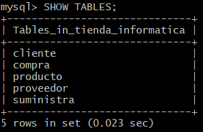

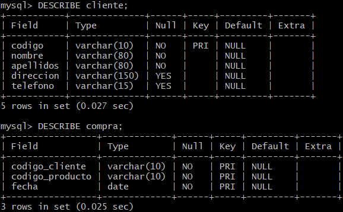

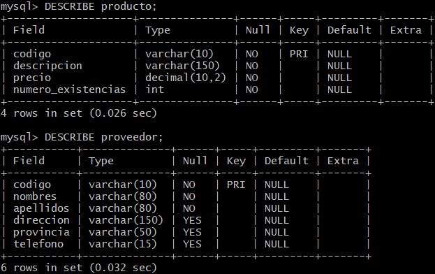

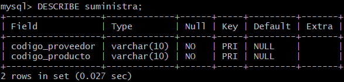


**Ver este ejercicio en:** [🔷 Entidad-Relación](../1_Entidad_Relacion/README.md#ejercicio-6) · [🔶 Relacional](../2_Relacional/README.md#ejercicio-6)

[⬆ Volver al índice](#índice) · [🏠 Volver al inicio](../../README.md)

---

<a id="ejercicio-7"></a>

## Ejercicio 7: Discos Musicales

📄 Archivo: [`07_discos_musicales.sql`](07_discos_musicales.sql)

```sql
CREATE DATABASE discos_musicales;
USE discos_musicales;

CREATE TABLE Genero (
    identificador  VARCHAR(10) PRIMARY KEY
);

CREATE TABLE Cantante (
    identificador  VARCHAR(10) PRIMARY KEY,
    nombre         VARCHAR(80) NOT NULL,
    pais           VARCHAR(50)
);

CREATE TABLE Disco (
    identificador           VARCHAR(10)   PRIMARY KEY,
    titulo                  VARCHAR(100)  NOT NULL,
    precio                  DECIMAL(8,2)  NOT NULL,
    identificador_genero    VARCHAR(10)   NOT NULL,
    identificador_cantante  VARCHAR(10)   NOT NULL,
    FOREIGN KEY (identificador_genero)   REFERENCES Genero(identificador),
    FOREIGN KEY (identificador_cantante) REFERENCES Cantante(identificador)
);

CREATE TABLE Cancion (
    identificador  VARCHAR(10)  PRIMARY KEY,
    titulo         VARCHAR(100) NOT NULL
);

CREATE TABLE Tiene (
    identificador_disco    VARCHAR(10),
    identificador_cancion  VARCHAR(10),
    posicion               INT NOT NULL CHECK (posicion > 0),
    PRIMARY KEY (identificador_disco, identificador_cancion),
    UNIQUE (identificador_disco, posicion),
    FOREIGN KEY (identificador_disco)   REFERENCES Disco(identificador),
    FOREIGN KEY (identificador_cancion) REFERENCES Cancion(identificador)
);
```

### Evidencia

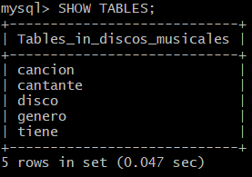

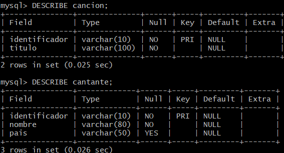

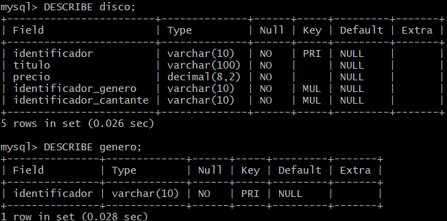

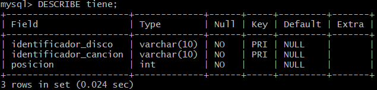


**Ver este ejercicio en:** [🔷 Entidad-Relación](../1_Entidad_Relacion/README.md#ejercicio-7) · [🔶 Relacional](../2_Relacional/README.md#ejercicio-7)

[⬆ Volver al índice](#índice) · [🏠 Volver al inicio](../../README.md)

---

<a id="ejercicio-8"></a>

## Ejercicio 8: Camiones

📄 Archivo: [`08_camiones.sql`](08_camiones.sql)

```sql
CREATE DATABASE camiones;
USE camiones;

CREATE TABLE Camionero (
    cedula     VARCHAR(10)    PRIMARY KEY,
    nombre     VARCHAR(80)    NOT NULL,
    telefono   VARCHAR(15),
    direccion  VARCHAR(150),
    salario    DECIMAL(10,2),
    poblacion  VARCHAR(80)
);

CREATE TABLE Provincia (
    codigo  VARCHAR(10) PRIMARY KEY,
    nombre  VARCHAR(50) NOT NULL
);

CREATE TABLE Camion (
    matricula  VARCHAR(10) PRIMARY KEY,
    modelo     VARCHAR(50),
    tipo       VARCHAR(30),
    potencia   INT
);

CREATE TABLE Paquete (
    codigo                  VARCHAR(10)   PRIMARY KEY,
    descripcion             VARCHAR(150),
    destinatario            VARCHAR(80)   NOT NULL,
    direccion_destinatario  VARCHAR(150)  NOT NULL,
    cedula_camionero        VARCHAR(10)   NOT NULL,
    codigo_provincia        VARCHAR(10)   NOT NULL,
    FOREIGN KEY (cedula_camionero) REFERENCES Camionero(cedula),
    FOREIGN KEY (codigo_provincia) REFERENCES Provincia(codigo)
);

CREATE TABLE Conduce (
    cedula_camionero  VARCHAR(10),
    matricula_camion  VARCHAR(10),
    fecha             DATE,
    PRIMARY KEY (cedula_camionero, matricula_camion, fecha),
    FOREIGN KEY (cedula_camionero) REFERENCES Camionero(cedula),
    FOREIGN KEY (matricula_camion) REFERENCES Camion(matricula)
);
```

### Evidencia

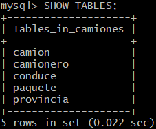

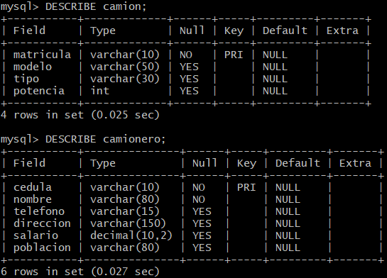

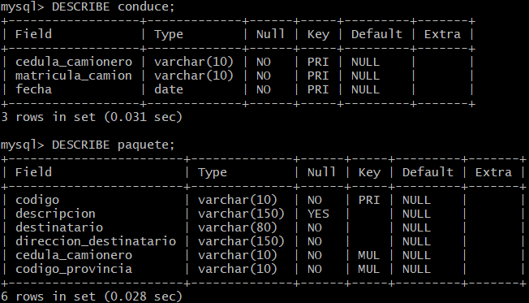

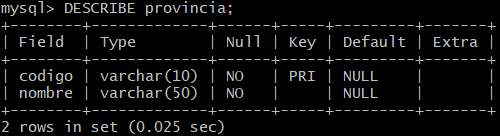


**Ver este ejercicio en:** [🔷 Entidad-Relación](../1_Entidad_Relacion/README.md#ejercicio-8) · [🔶 Relacional](../2_Relacional/README.md#ejercicio-8)

[⬆ Volver al índice](#índice) · [🏠 Volver al inicio](../../README.md)

---

<a id="ejercicio-9"></a>

## Ejercicio 9: Veterinaria

📄 Archivo: [`09_veterinaria.sql`](09_veterinaria.sql)

```sql
CREATE DATABASE veterinaria;
USE veterinaria;

CREATE TABLE Propietario (
    cedula     VARCHAR(10)  PRIMARY KEY,
    apellidos  VARCHAR(80)  NOT NULL,
    nombres    VARCHAR(80)  NOT NULL,
    direccion  VARCHAR(150)
);

CREATE TABLE Telefono_propietario (
    cedula_propietario  VARCHAR(10),
    telefono            VARCHAR(15),
    PRIMARY KEY (cedula_propietario, telefono),
    FOREIGN KEY (cedula_propietario) REFERENCES Propietario(cedula)
        ON DELETE CASCADE
);

CREATE TABLE Familiar_contacto (
    cedula_propietario  VARCHAR(10) UNIQUE,
    cedula              VARCHAR(10),
    nombre              VARCHAR(80) NOT NULL,
    telefono            VARCHAR(15),
    PRIMARY KEY (cedula_propietario, cedula),
    FOREIGN KEY (cedula_propietario) REFERENCES Propietario(cedula)
        ON DELETE CASCADE
);

CREATE TABLE Mascota (
    identificador       VARCHAR(10) PRIMARY KEY,
    nombre              VARCHAR(50) NOT NULL,
    fecha_nacimiento    DATE,
    tipo                VARCHAR(30),
    cedula_propietario  VARCHAR(10) NOT NULL,
    FOREIGN KEY (cedula_propietario) REFERENCES Propietario(cedula)
);

CREATE TABLE Personal (
    codigo  VARCHAR(10) PRIMARY KEY,
    cedula  VARCHAR(10) NOT NULL UNIQUE,
    nombre  VARCHAR(80) NOT NULL
);

CREATE TABLE Veterinario (
    codigo        VARCHAR(10) PRIMARY KEY,
    fecha_alta    DATE        NOT NULL,
    especialidad  VARCHAR(50),
    FOREIGN KEY (codigo) REFERENCES Personal(codigo)
);

CREATE TABLE Auxiliar (
    codigo           VARCHAR(10)    PRIMARY KEY,
    base_cotizacion  DECIMAL(10,2)  NOT NULL,
    FOREIGN KEY (codigo) REFERENCES Personal(codigo)
);

CREATE TABLE Pasa_consulta (
    identificador_mascota  VARCHAR(10),
    codigo_veterinario     VARCHAR(10),
    fecha                  DATE,
    diagnostico            VARCHAR(255),
    PRIMARY KEY (identificador_mascota, codigo_veterinario, fecha),
    FOREIGN KEY (identificador_mascota) REFERENCES Mascota(identificador),
    FOREIGN KEY (codigo_veterinario)    REFERENCES Veterinario(codigo)
);
```

### Evidencia

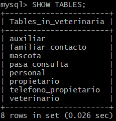

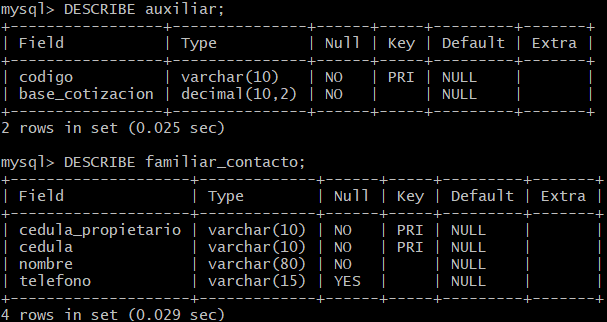

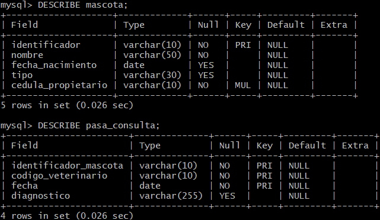

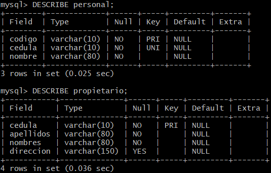

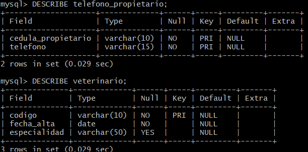


**Ver este ejercicio en:** [🔷 Entidad-Relación](../1_Entidad_Relacion/README.md#ejercicio-9) · [🔶 Relacional](../2_Relacional/README.md#ejercicio-9)

[⬆ Volver al índice](#índice) · [🏠 Volver al inicio](../../README.md)

---
